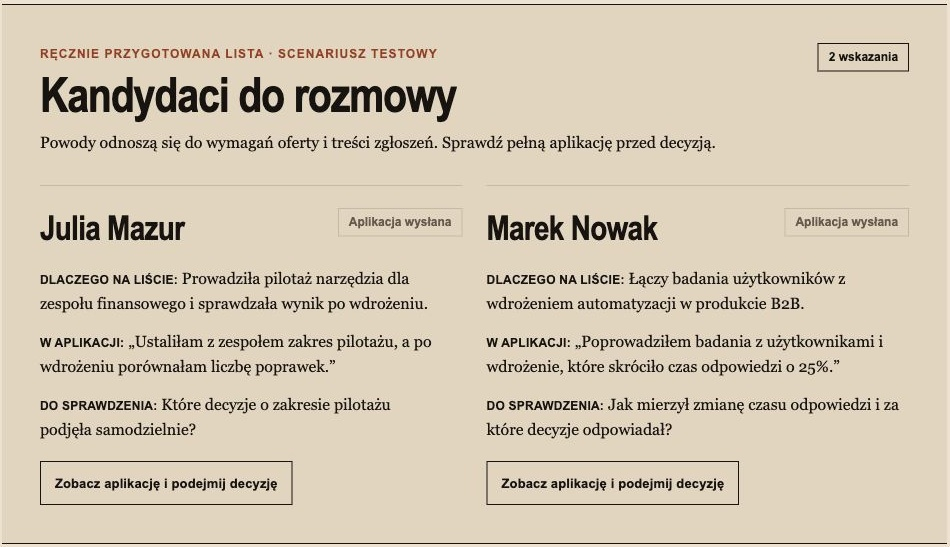
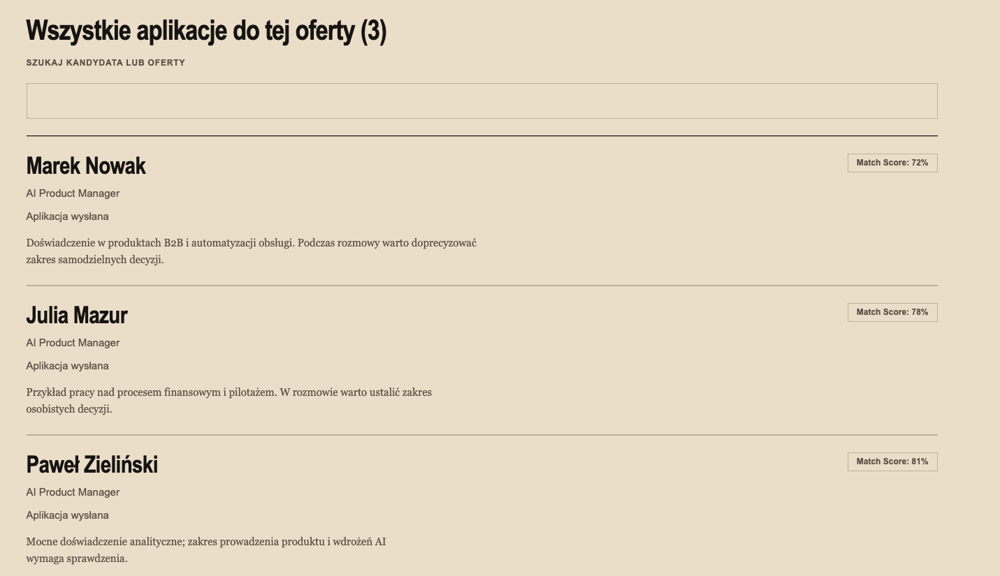
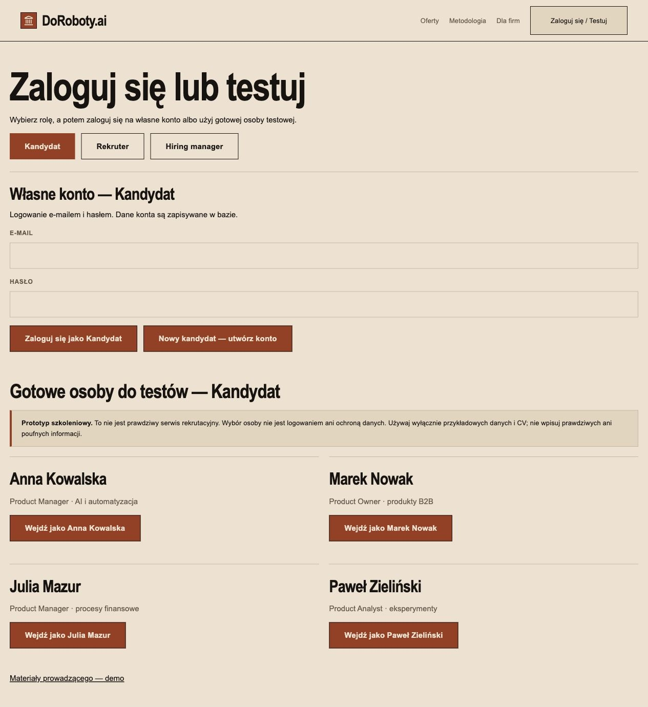
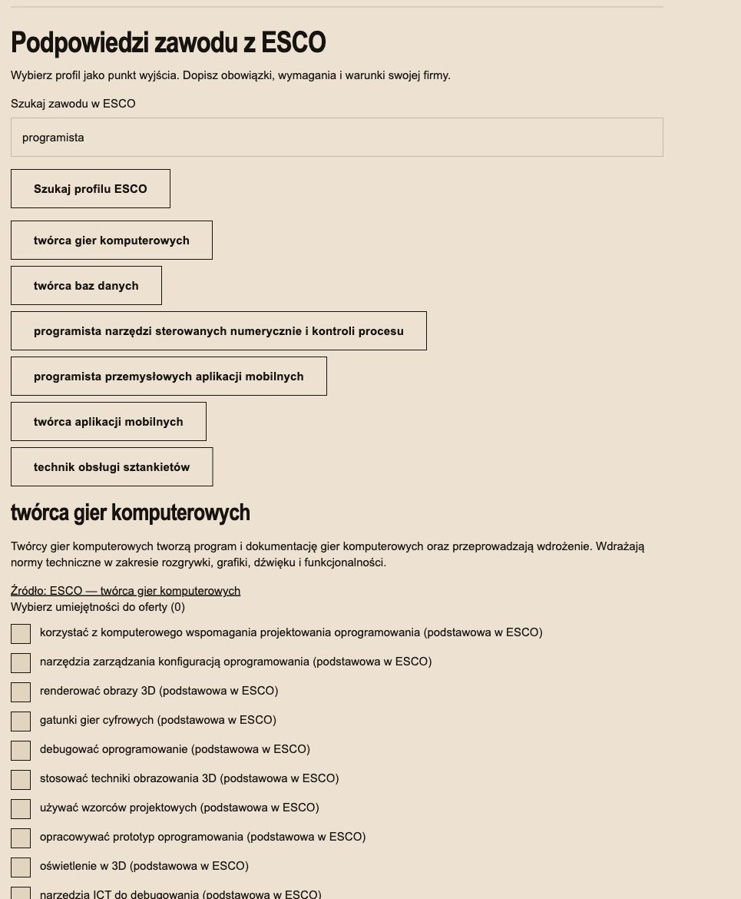

# DoRoboty.ai - Super Sprint

Piotr Skrzypek | AI Product Heroes 3 | 23.11.2026

## 1. Od zgłoszeń do wartościowych rozmów

DoRoboty.ai | Piotr Skrzypek | AI Product Heroes 3 | 23.11.2026

### Produkt i misja

DoRoboty.ai jest fikcyjnym portalem pracy związanej z AI. Wybrana misja: pomagać kandydatom bezpiecznie i wiarygodnie pokazywać własny wkład w projekty zespołowe i poufne, żeby pracodawcy mogli lepiej ocenić ich kompetencje. [S1,S4]

### Cel biznesowy

Zwiększyć odsetek pracodawców dokonujących nowego płatnego zakupu w ciągu 90 dni z 30% do 60%. Jest to cel briefu, nie osiągnięty wynik. Wykorzystanie publikacji z wcześniej kupionego pakietu nie jest nowym zakupem. [S1]

### Wybrana ścieżka discovery

O05: po publikacji pracodawca chce znaleźć kilka osób wartych rozmowy bez czytania każdej aplikacji od początku. / I01: rekruter ręcznie przygotowuje krótką listę, podaje powody powiązane z wymaganiami oraz kwestie do sprawdzenia. Pracodawca podejmuje decyzję. Wybór I01 zapisano 03.11.2026. [S4]

### Co wykonałem

Zbudowałem prototyp shortlisty i ręcznych podsumowań, przygotowałem oraz technicznie przetestowałem warianty A/B. Zebrałem feedback od 2 rekruterów i 2 osób szukających pracy, uwzględniłem go w PR-ach i przeprowadziłem retesty. Dodałem ESCO API po sugestii rekrutera. [S5,S7,S12,S14]

### Co pozostaje do sprawdzenia

Przewaga B w badaniu z uczestnikami, oszczędność czasu i trafność decyzji w rzeczywistej rekrutacji, koszt ręcznej obsługi oraz wpływ na North Star i ponowny zakup. Testy techniczne potwierdzają działanie wariantów, a nie skuteczność produktu.

### Aplikacja i materiały

Prototyp głównego rozwiązania I01: / [https://dorobotyaii.netlify.app/#/app/kandydaci?wariant=B](https://dorobotyaii.netlify.app/#/app/kandydaci?wariant=B) / [Wariant A - porównanie](https://dorobotyaii.netlify.app/#/app/kandydaci?wariant=A) · [Rozszerzona aplikacja - podgląd PR #6](https://deploy-preview-6--dorobotyaii.netlify.app/) / [Repozytorium GitHub](https://github.com/piotrskrzypek-svg/doroboty-ai) · [Praca w prywatnym ChatGPT](https://chatgpt.com/share/6b049098-fb80-83eb-90ad-a53ae7dcbe96)

Podstawą tej wersji jest pierwotne drzewko Discovery-v5: O05 → I01. Opisy stanowisk i ESCO są rozszerzeniami wspierającymi proces. Dane case’u, rzeczywiste testy autora i plany badań są oznaczone oddzielnie.

## 2. Drzewko Super Sprint

Skrót oryginalnego drzewa Discovery-v5; zachowane identyfikatory i decyzja z 03.11.2026. [S4]

**OUTCOME** Nowy płatny zakup tej samej firmy w 90 dni: kierunek 30% → 60%. Baza z briefu wymaga wspólnej definicji.

**SYGNAŁY Z CASE’U** F1: wartość to osoby warte rozmowy i mniej rund czytania. F3: niepewność własnego wkładu. [S2]

**DANE I KONTEKST** Match Score ≥75: 30% → 65%; zaproszenia: 23,9% → 23,5%. Badania rynku i konkurencji. [S3,S13]

**O01 / ALTERNATYWA** Ocenić własny wkład i praktyczną umiejętność przed rozmową.

**O05 / WYBRANA** Kilka osób wartych rozmowy bez czytania wszystkich aplikacji od początku.

**O03 / ALTERNATYWA** Wiedzieć, czy kandydat nadal chce rozmawiać.

**I01 / WYBRANY PROTOTYP** Ręczna lista aplikacji wartych rozmowy: uzasadnienie, fragment zgłoszenia i pytanie do sprawdzenia.

**I02 / ALTERNATYWA** Karta własnego wkładu kandydata: bezpieczny opis osobistej pracy, wyniku i granic odpowiedzialności.

**EXP3 / PLAN REALNEGO PILOTA** Ręczna lista w aktywnej rekrutacji. Obserwacja użycia powodów, zaproszeń i kosztu obsługi. [S4]

**EXP4 / PLAN ALTERNATYWNY** Papierowa karta wkładu: bezpieczne uzupełnienie i wykorzystanie przez rekrutera. [S4]

**ROZWÓJ I01 W TYGODNIU 4** Przygotowano warianty A/B i plan małego porównania użyteczności; testy techniczne wykonano. NSM: obustronna kontynuacja po rozmowie w 30 dni. Wpływ na zakup pozostaje hipotezą. [S14]

## 3. Lepszy wynik tekstu nie wystarcza

Źródło: fikcyjne dane kursowe. Obliczenia sprawdzono ponownie w CSV; nie są wynikiem mojego prototypu.

| Wskaźnik                                               | Maj 2026               | Czerwiec 2026          |
| ------------------------------------------------------ | ---------------------- | ---------------------- |
| Liczba aplikacji                                       | 18 000                 | 18 000                 |
| Match Score co najmniej 75                             | 5 400 / 18 000 / 30%   | 11 700 / 18 000 / 65%  |
| Zaproszenia wśród zapisanych decyzji screeningu        | 2 400 / 10 050 / 23,9% | 2 400 / 10 222 / 23,5% |
| Kontynuacja wśród zapisanych wyników pierwszej rozmowy | 540 / 1 800 / 30%      | 540 / 1 800 / 30%      |
| Publikacje z pomocą asystenta                          | 0 / 300 = 0%           | 210 / 300 = 70%        |
| Aplikacje z pomocą asystenta                           | 0 / 18 000 = 0%        | 11 700 / 18 000 = 65%  |

### Interpretacja

Wzrost Match Score nie przełożył się na wyższy udział zaproszeń ani kontynuacji w tych zestawieniach. Wynik ocenia tekst, nie praktyczne kompetencje. To uzasadnia sprawdzenie sposobu wyboru osób, ale nie dowodzi skuteczności shortlisty ani związku przyczynowego z asystentami. [S3]

### Zakupy z pełnym oknem obserwacji

W eksporcie: 2916 transakcji, 1874 firmy. W roboczej kohorcie 748/1549 firm = 48,3% dokonało późniejszego zakupu do 90 dni od pierwszej obserwowanej transakcji. Warunek pełnego okna: zakup bazowy najpóźniej 30.06.2026 o 16:00; ostatni zakup w eksporcie 28.09.2026 o 16:00. [S3]

Pierwsza obserwowana transakcja może nie być pierwszą w historii firmy. Definicja bazowych 30% CEO jest nieznana, dlatego 48,3% nie oznacza poprawy od 30%. Puste decyzje nie wchodzą do mianowników decyzji w tabeli; brak zapisu nie dowodzi braku zdarzenia poza portalem. Kontynuacja nie oznacza zatrudnienia.

## 4. Dlaczego warto sprawdzić shortlistę

Łączę wywiady i CSV z case’u z badaniami rynku. Źródła pełnią różne role; nie są jednakowo silnym dowodem.

### F1 / wartość ogłoszenia

„Że dostajemy osoby, z którymi warto rozmawiać, i da się do nich dotrzeć bez tylu rund czytania.” / F1 wiąże wartość z rozmowami i wysiłkiem selekcji. To bezpośredni sygnał dla O05. Nie zmierzono czasu ani gotowości zapłaty za shortlistę. [S2]

### F3 / niepewność oceny oraz F2 / aktualność zgłoszeń

F3 chce uczciwie rozpoznać praktyczne kompetencje przed zaproszeniem; nie wie, jaki materiał to umożliwi. F2 dowiaduje się o braku zainteresowania dopiero po wysłaniu zaproszenia. To podstawa alternatyw O01 i O03. Rozmowy kandydatów wnoszą problem poufności i własnego wkładu. [S2]

### Zgodność i granice wniosku

Wywiady wskazują koszt oceny, a dane pokazują, że więcej wysokich wyników tekstowych nie musi oznaczać więcej zaproszeń. Wspólnie uzasadniają eksperyment z I01. Nie dowodzą, że brak shortlisty jest przyczyną braku zakupów: follow-upy ujawniają także brak nowego wakatu lub zgody budżetowej. [S2,S3]

| Badanie / źródło                   | Wniosek dla projektu                                                                                                                                                   |
| ---------------------------------- | ---------------------------------------------------------------------------------------------------------------------------------------------------------------------- |
| Market Scout i desk research       | Makrodane o rynku pracy i AI dają kontekst. Nie ustalają liczby nabywców rozwiązania ani ponownego zakupu portalu w 90 dni.                                            |
| Rival Radar: No Fluff Jobs         | ATS i narzędzia AI wspierają selekcję oraz przygotowanie ogłoszeń. Sama obecność podobnych funkcji u konkurenta nie potwierdza skuteczności I01.                       |
| Rival Radar: Wellfound i polecenia | Wellfound oferuje ATS, sourcing i wsparcie rekrutera; polecenia są alternatywnym kanałem w case’owych rozmowach. Porównanie wskazuje różne sposoby osiągania wartości. |

Badania zachowano w Discovery-v5 [S13]. Aktualny zakres ofert dostawców sprawdzono 23.11: [No Fluff Jobs](https://nofluffjobs.com/pl/employers/) oraz [Wellfound](https://wellfound.com/recruit/pricing). Są to deklaracje dostawców; nie podaję niepotwierdzonych cen ani wyniku skuteczności. Osiem wywiadów F1-F4 i C1-C4 to fikcyjny case, nie czterech testerów prototypu.

## 5. Decyzja: O05 → I01

Oryginalne oceny PRES i wybór z 03.11.2026. P = ból, R = zasięg, E = dowody, S = związek z celem. [S4]

| Szansa                                                               | P / R / E / S | Uzasadnienie                                                                        |
| -------------------------------------------------------------------- | ------------- | ----------------------------------------------------------------------------------- |
| O05. Osoby warte rozmowy bez ponownego czytania wszystkich zgłoszeń. | 3 / ? / 2 / 4 | Wybrana. F1 bezpośrednio łączy wartość ogłoszenia z rozmowami i wysiłkiem selekcji. |
| O01. Ocena osobistego wkładu i praktycznej umiejętności.             | 3 / ? / 2 / 3 | Alternatywa: F1/F3/F4 opisują niepewność; wpływ na zakup jest pośredni.             |
| O03. Aktualna chęć kandydata do rozmowy.                             | 2 / ? / 2 / 2 | Alternatywa: przykład F2; brak pomiaru skali i związku z zakupem.                   |

P/E/S to osądy analityczne w skali 1-5, nie pomiar. Zasięg wszystkich potrzeb jest nieznany. Nie liczę sum ani rankingu; O05 wybrano decyzją autora. Brak reprezentatywności i potwierdzenia zakupowego ogranicza ocenę dowodów.

### I01 / wybrane rozwiązanie

Ręcznie przygotowana lista aplikacji wartych rozmowy. Pozwala sprawdzić użycie konkretnych powodów wyboru i koszt obsługi, zanim powstanie automatyczna rekomendacja. Uzasadnienie ma prowadzić do oceny zgłoszenia; rekruter nie gwarantuje kompetencji kandydata.

### I02 / druga propozycja w oryginalnym drzewku

Karta własnego wkładu przy aplikacji: kontekst, osobista praca, rezultat, granice udziału zespołu i bezpieczny przykład. Bliżej misji produktu, ale dodaje kandydatowi wysiłku. Potrzeba sprawdzenia, czy zostanie uzupełniona i użyta przez pracodawcę.

### Trzecie podejście / wcześniejsza eksploracja

Krótszy przepływ screeningu: kryteria roli, nierozstrzygnięte aplikacje i sugerowany następny krok. Występuje w historycznym materiale ideas/test-vehicles.md. Zachowuję je jako rozważaną alternatywę; nie było trzecim zatwierdzonym pomysłem bieżącej gałęzi drzewa.

Dwa pomysły w drzewku oraz trzecie podejście historyczne pokazują rzeczywisty przebieg pracy. ESCO jest późniejszym rozszerzeniem po feedbacku, a nie dopisaną wstecz alternatywą dla I01.

## 6. I01: ręczna lista z uzasadnieniami

Główny prototyp jest dostępny online. Zrzut wariantu B z 23.11.2026. [S12,S14]

### Otwórz i porównaj

B - wybrane rozwiązanie: [https://dorobotyaii.netlify.app/#/app/kandydaci?wariant=B](https://dorobotyaii.netlify.app/#/app/kandydaci?wariant=B) / A - punkt odniesienia: [https://dorobotyaii.netlify.app/#/app/kandydaci?wariant=A](https://dorobotyaii.netlify.app/#/app/kandydaci?wariant=A) / Linki otwierają Karolinę z BrightLabs, rolę AI Product Manager i te same trzy syntetyczne zgłoszenia. B dodaje dwie ręcznie przygotowane rekomendacje.

### Mechanizm

Przy każdej osobie są: powód umieszczenia na liście, fragment aplikacji i pytanie do sprawdzenia. Przycisk prowadzi do pełnego zgłoszenia i decyzji. Rekruter przygotowuje wskazania; hiring manager zachowuje kontrolę. Wszystkie trzy aplikacje nadal są dostępne poniżej.

### Założenie do sprawdzenia

Widoczne powody mają pomóc szybciej wybrać osoby do rozmowy, bez pogorszenia podstaw decyzji. Działający ekran potwierdza implementację, ale nie oszczędność czasu. Przed ostateczną decyzją interfejs zaleca sprawdzenie pełnej aplikacji.

Warianty korzystają z danych syntetycznych i odrębnej sesji w przeglądarce. Zapis etapu nie wysyła prawdziwego zaproszenia. Wynik Match Score nie jest zweryfikowaną oceną umiejętności. Scenariusz i testy: s. 8.

## 7. Notatka rekrutera wspiera wybór

Ręczne podsumowania ułatwiają hiring managerowi wstępne porównanie zgłoszeń.

### Związek z potrzebą

Notatki i podsumowania są elementem kierunku O05/I01: mają ograniczyć wielokrotne czytanie wszystkich aplikacji od początku. Pomagają wskazać doświadczenie istotne dla roli oraz kwestie do rozmowy. To centralny element projektu, obok jawnej shortlisty.

Zrzut przekazany przez autora, zgodny z odczytanym widokiem demo [S12]. Pokazuje podsumowania na liście, nie formularz edycji notatki.

### Trzy elementy wdrożenia

1. Wszystkie aplikacje mają krótkie podsumowania, jak na zrzucie. / 2. Shortlista zawiera ręczne wskazania z powodem, dowodem i pytaniem. / 3. Szczegół zgłoszenia w podglądzie PR #6 ma osobne pole „Notatka rekrutacyjna”; UI opisuje zapis w historii przy zmianie etapu.

### Jak sprawdzić

W [rozszerzonym podglądzie PR #6](https://deploy-preview-6--dorobotyaii.netlify.app/) wybierz demo rekrutera → Karolina Wiśniewska → Kandydaci → AI Product Manager → Julia Mazur. Lista wariantu B jest dostępna także bezpośrednio przez [link na s. 6](https://dorobotyaii.netlify.app/#/app/kandydaci?wariant=B).

Potwierdzono widoki i obecność pola notatki. Nie sprawdzono tutaj zapisu tej notatki ani przekazania jej między kontami. Wpływ na czas i trafność wyboru hiring managera wymaga badania z uczestnikami.

## 8. A/B: co zrobiono, co zaplanowano

Plan przygotowany i zweryfikowany skillem product-discovery:ab-test-design 17.11.2026. [S14]

### Wykonane: warianty i testy techniczne

Opublikowałem A (trzy zgłoszenia bez shortlisty) i B (te same zgłoszenia z dwiema rekomendacjami). Naprawiono pustą listę wynikającą ze starej osoby i oferty w przeglądarce. Linki uruchamiają odizolowany scenariusz Karoliny i trzech aplikacji.

### Zakres potwierdzenia technicznego

Zapis w repozytorium dokumentuje 34 testy jednostkowe i 3 ukierunkowane testy przeglądarkowe po izolacji sesji: wejście do A/B, szczegóły, zapis etapu, odświeżenie, zmianę wariantu i zachowanie wcześniejszych danych. Typy, lint i build przeszły. Pełny skrypt verify zatrzymał się na wcześniejszym formatowaniu raportu HTML; nie deklaruję pełnego przejścia tej bramki.

Autor potwierdził 23.11: wykonano tylko techniczne testy A/B. Są odrębne od feedbacku czterech osób. Ponowny odczyt UI 23.11 potwierdził różnicę A/B; nie powtarzano całego zestawu automatycznego. [S5,S12,S14]

### Plan z uczestnikami / jeszcze niewykonany

Hipoteza: B ułatwia samodzielny wybór osoby i zapisanie zaproszenia w 10 minut. Plan obejmuje 4-7 znajomych odgrywających rolę pracodawcy. Każdy widzi jeden wariant, w nowym oknie prywatnym. Przydział przygotowany przed sesjami: P01 B, P02 A, P03 B, P04 A, P05 A, P06 B, P07 A.

| Pomiar                        | Reguła protokołu                                                                                                                                                              |
| ----------------------------- | ----------------------------------------------------------------------------------------------------------------------------------------------------------------------------- |
| Zadanie i główna metryka      | Wybrać osobę do pierwszej rozmowy i zapisać decyzję. Samodzielne „Zaproszenie na rozmowę” do 10 min / wszystkie osoby przydzielone. Pomoc lub brak ukończenia = 0 w liczniku. |
| Zabezpieczenie jakości        | Osoby wskazujące fakt z aplikacji powiązany z wymaganiem / wszystkie przydzielone. W B także rozumienie, że listę przygotował człowiek.                                       |
| Decyzja po wszystkich sesjach | B obiecujący: wyższy udział ukończeń bez spadku jakości i mylenia listy z AI. Pogorszenie: poprawka i pozostanie przy A. Wynik mieszany: nierozstrzygający.                   |

Wyniki uczestników trzeba zapisywać ręcznie. PostHog nie przypisuje ich do wariantu. Przy 4-7 osobach to kierunkowe porównanie użyteczności, nie dowód istotności statystycznej ani wzrostu 30-dniowego North Star.

## 9. Jak sprawdzić wartość w rekrutacji

EXP3 i EXP4 z bet-packu 03.11.2026 to plany; techniczne testy A/B nie realizują tych badań. [S4]

### EXP3 / ręczna shortlista w aktywnej rekrutacji

Uzgodnić z jednym pracodawcą kryteria konkretnej roli przed przeglądem aplikacji. Rekruter przygotowuje krótką listę prawdziwych zgłoszeń z powodami odniesionymi do tych kryteriów. Pracodawca sam wybiera, kogo zaprosić. Pierwszy krok: uzgodnienie dostępu i warunków pilota.

### EXP3 / obserwacje i decyzja

Zapisać użycie uzasadnień, rzeczywiste zaproszenia w proponowanym oknie 5 dni roboczych oraz czas ręcznej pracy i przeglądu. Uwzględnić wszystkie dostarczone listy, również bez działania. Użycie powodów, zaproszenia i wykonalna obsługa uzasadnią dalsze porównanie; brak działania lub zaufania do powodów wymaga zmiany. Brak dostępu albo zgłoszeń daje wynik nierozstrzygający.

Pięć dni jest proponowanym oknem obserwacji, nie progiem sukcesu. Plan nie ustala liczbowej przewagi nad kontrolą ani dopuszczalnego kosztu. Te wartości trzeba uzgodnić przed badaniem; nie zostały osiągnięte w testach technicznych.

### EXP4 / karta własnego wkładu

Alternatywa dla I02: dobrowolna papierowa karta w rzeczywistej rekrutacji. Kandydat opisuje kontekst, własny udział, rezultat i bezpieczny przykład. Sprawdzić, czy potrafi ją uzupełnić bez poufnych materiałów oraz czy rekruter wykorzystuje informacje w pytaniu lub decyzji.

### EXP4 / obserwacje i decyzja

Zapisać liczbę osób zaproszonych do wypełnienia, ukończonych kart, rekruterów, którzy je otrzymali, oraz przykłady użycia. Samo wypełnienie nie wystarcza. Użycie bez problemów poufności uzasadnia kolejny test; duże obciążenie lub brak zastosowania oznacza uproszczenie bądź odrzucenie. Plan nie ma zatwierdzonego progu liczbowego.

### Kolejność i dalsze badanie porównawcze

Najpierw I01; I02 później albo warunkowo w tej samej rekrutacji. Po pilocie i ustaleniu pomiaru można porównywać A/B z rzeczywistymi firmami: stały przydział firmy, wspólny zapis zdarzeń, pełne 30 dni obserwacji, próbę policzoną z baseline’u i uwzględnieniem wielu ofert jednej firmy. [S4,S14]

## 10. Wartość potwierdzona przez obie strony

Gra: transakcje. Definicja zaakceptowana 17.11.2026; nie jest jeszcze policzoną metryką. [S14]

### North Star

Odsetek płatnych ofert, które w ciągu 30 dni od publikacji doprowadziły do co najmniej jednej obustronnie zaakceptowanej kontynuacji po rozmowie.

### Dokładna definicja

Mianownik: wszystkie płatne oferty opublikowane w danym miesiącu, z pełnym 30-dniowym oknem obserwacji. / Licznik: unikalne oferty, dla których kandydat aplikował przez portal, odbyła się pierwsza rozmowa, pracodawca zaproponował konkretny kolejny etap, a kandydat go przyjął - wszystko w tym oknie. Jedna oferta liczy się najwyżej raz.

| Dźwignia i kierunek                                     | Związek z projektem                                                                                             |
| ------------------------------------------------------- | --------------------------------------------------------------------------------------------------------------- |
| Więcej ofert z konkretnymi wymaganiami i warunkami      | Formularz oferty i ESCO wspierają przygotowanie treści. Pracodawca musi dopisać realny kontekst firmy.          |
| Więcej aplikacji z bezpiecznym opisem osobistego wkładu | I02: dobrowolna karta wkładu jako alternatywny kierunek.                                                        |
| Krótsza mediana od publikacji do pierwszego zaproszenia | I01: shortlista i notatki mają ułatwić wybór. Techniczne A/B sprawdza działanie mechanizmu, nie zmianę mediany. |
| Większy udział zaproszeń zakończonych odbytą rozmową    | Jasny status i ustalanie terminu jako dalszy kierunek; sama liczba zaproszeń nie wystarcza.                     |

### Dlaczego może zapowiadać ponowny zakup

Obustronny postęp jest bliższy wartości rekrutacji niż liczba aplikacji lub wysoki Match Score. Hipoteza: większa wartość sprzyja nowemu zakupowi w 90 dni. Wynik NSM musi wystąpić przed zakupem; trzeba też uwzględnić nowy wakat i budżet.

Obecny eksport nie rejestruje kompletu zdarzeń: propozycji i przyjęcia kolejnego etapu. Case’owe „kontynuujemy proces” to decyzja pracodawcy, nie obustronna NSM. Nie wyliczam North Star z 540/1800 ani nie utożsamiam jej z wynikiem A/B.

## 11. Feedback czterech testerów

2 rekruterzy + 2 osoby szukające pracy. To odrębne testy od technicznej weryfikacji A/B. [S5]

| Zgłoszona uwaga                                          | Działanie i status                                                                                                                      |
| -------------------------------------------------------- | --------------------------------------------------------------------------------------------------------------------------------------- |
| Nie działało logowanie.                                  | Uwzględniłem feedback w PR-ach. Po poprawkach retesty były OK. Historia prac dokumentuje rejestrację kandydata i wspólny ekran wejścia. |
| Za mało ofert i kandydatów testowych.                    | Uzupełniłem dane do sprawdzania aplikacji; uwagi uwzględniono w rozwoju i PR-ach. Według mojej relacji po retestach było OK.            |
| Sugestia jednego rekrutera: integracja z bazą stanowisk. | Wdrożyłem ESCO API, aby łatwiej przygotowywać opis stanowiska i dobierać umiejętności. Dowód i zakres: s. 12.                           |

Relacja autora potwierdza udział osób, uwagi, poprawki i pozytywny retest. Nie zawiera wyników oddzielnych sesji, czasów ani porównania A z B. Nie przypisuję każdej poprawki do konkretnego commita bez takiego dowodu.

### Odnaleziony zapis uzupełnienia przykładów

Czat Codex „Dodaj oferty i aplikacje” dokumentuje dodanie 20 ofert i łącznie 25 nowych zgłoszeń w dwóch krokach (5 + 20). Zmiany dotyczyły lokalnego scenariusza demo w używanej przeglądarce. Nie ma podstaw, aby deklarować wykonanie wszystkich pierwotnie zamówionych 50 zgłoszeń ani widoczność tych danych w każdej świeżej sesji. [S15]

Wniosek z iteracji / Działające wejście i wystarczająca liczba przykładów umożliwiają sprawdzenie ścieżek produktu. Feedback doprowadził też do nowej funkcji ESCO. / / Granica dowodu / Retest OK potwierdza ocenę poprawki przez autora. Nie mierzy oszczędności czasu, jakości rekrutacji ani wzrostu zakupów.

## 12. ESCO API pomaga opisać stanowisko

Sugestia jednego rekrutera → wdrożona funkcja w prototypie → widoczny profil i umiejętności.

Jak dotrzeć do funkcji / [Otwórz wersję ze zrzutu](https://6afe0eb8dc93d99ddd01332b--dorobotyaii.netlify.app/) → wejście do demo → rekruter (Karolina) → dodanie oferty → wyszukiwanie zawodu ESCO. / / Zadanie / Wpisz „programista”, wybierz profil, przejrzyj opis i umiejętności. Dodaj wybrane treści i uzupełnij zadania oraz warunki firmy.

Potwierdzenie działania / 23.11 wybór profilu „twórca gier komputerowych” zwrócił polski opis, źródło ESCO i umiejętności. Sprawdzono odczyt; ten zrzut nie dowodzi zapisu oferty.

### Co daje integracja

Punkt wyjścia do opisu i uporządkowany słownik umiejętności. Pracodawca zachowuje kontrolę nad tekstem. API nie zna sytuacji konkretnej firmy, wynagrodzenia ani faktycznego sposobu użycia AI. Nie należy publikować standardowego opisu bez sprawdzenia.

### Zakres implementacji

PR #4 dodaje wyszukiwanie przez funkcję Netlify i edytowalne podpowiedzi. PR #5 dodaje zapis pełnej oferty oraz danych ESCO jako prywatnego szkicu w Supabase. PR #6 łączy te zmiany ze wspólnym wejściem do aplikacji. Są to rozszerzenia w podglądach testowych. [S7-S9]

[Kod integracji: PR #4](https://github.com/piotrskrzypek-svg/doroboty-ai/pull/4) · [Rozszerzony prototyp: PR #6](https://deploy-preview-6--dorobotyaii.netlify.app/) / Zrzut powyżej pochodzi z wcześniejszego podglądu zawierającego ESCO i Supabase: [wersja 6afe0eb8…](https://6afe0eb8dc93d99ddd01332b--dorobotyaii.netlify.app/)

## 13. Opis oferty i ESCO wspierają proces

Plany E1/E2 zaakceptowane 23.11.2026 jako uzupełnienie. Nie zastępują pierwotnych I01 i EXP3. [S16]

### Rola rozszerzeń w całym projekcie

Konkretny opis roli może pomóc kandydatowi dobrać przykład doświadczenia, a rekruterowi ustalić wymagania przed selekcją. To wspiera pierwszą dźwignię North Star. ESCO jest punktem wyjścia do opisu; nie zna zadań, wynagrodzenia i praktyki AI w danej firmie. Związek z jakością zgłoszeń wymaga badania.

### E1 / rozumienie oferty przez kandydatów

5 kandydatów rozważających podobne role wybierze ofertę, wyjaśni zadania, zastosowanie AI i warunki, a następnie uzasadni dalszy krok. Mierzę trafność rozumienia, kompletność informacji, pomoc i przerwania. Dalej: co najmniej 4/5 rozpoczętych sesji kończy się samodzielnym zrozumieniem i decyzją opartą na wystarczających informacjach.

Krytyczny brak treści oznacza niespełnienie kryterium sesji, nawet gdy kandydat trafnie go wskaże. Każdą taką lukę poprawiam; poniżej 4/5 powtarzam test po korekcie. Fikcyjna oferta pozwala badać rozumienie, nie rzeczywiste aplikowanie.

### E2 / przygotowanie opisu z ESCO

3 rekruterów przygotuje po dwa opisy dla porównywalnych briefów: dotychczasową metodą i z ESCO. Zmieniam kolejność metod między osobami i zapisuję używane wcześniej narzędzia. Brief określa zadania, warunki i zastosowanie AI.

### E2 / pomiar i decyzja

Porównam czas, poprawki i potrzebną pomoc oraz zgodność treści z briefem: zadania, warunki, AI, umiejętności i brak nieuprawnionych dopisków. Powtarzająca się korzyść czasu lub mniejsza liczba poprawek bez pogorszenia jakości uzasadni dalszy rozwój. Wynik mieszany wymaga dalszego sprawdzenia; błędny profil i ogólniki wymagają korekty.

### Status i powiązanie z pierwotnym drzewem

E1/E2 nie zostały przeprowadzone. Pochodzą z późniejszego cyklu dotyczącego opisu oferty; zachowuję je jako plany uzupełniające. Wersja zaliczeniowa prowadzi główną historię przez O05 → I01, testy techniczne A/B i plan oceny wartości shortlisty.

Małe próby dadzą sygnały kierunkowe. Nie zakładam z góry procentowej oszczędności ani istotności statystycznej. Wyniki należy raportować dla wszystkich rozpoczętych sesji, także niepowodzeń.

## 14. Co działa i skąd pochodzi

Część projektu realizowałem na prywatnym koncie ChatGPT, równolegle do pracy nad discovery i Canvasem.

| Obszar              | Zakres i stan                                                                                                                                                                                                           |
| ------------------- | ----------------------------------------------------------------------------------------------------------------------------------------------------------------------------------------------------------------------- |
| Baza kursowa / demo | Projekt jest forkiem aplikacji superhero-tech/doroboty-ai. Gotowe osoby, publiczne przykładowe oferty oraz scenariusze AI i scoringu służą demonstracji. Wybór osoby demo nie jest uwierzytelnieniem.                   |
| Supabase            | W podglądach: własne konta, rejestracja kandydata, zapis zgłoszeń i dostęp przypisanego rekrutera. Rozmowa dokumentuje wysłanie i odczyt zgłoszenia. Prywatne szkice ofert i dane ESCO dodano w PR #5. [S6,S8]          |
| ESCO API            | Rzeczywiste pobieranie profili zawodów i umiejętności, nie symulacja odpowiedzi generatywnego AI. W tej weryfikacji potwierdzono wyszukiwanie i odczyt profilu w UI. [S7]                                               |
| PostHog             | PR #1 i #2 dodają odsłony oraz Autocapture z maskowaniem treści. Rozmowa potwierdza odbiór odsłon; nie dostarcza końcowego potwierdzenia odbioru kliknięć. Nie używam tych zdarzeń jako dowodu wyników testów. [S6,S10] |
| Wersje wdrożenia    | PR #3-6 pozostają otwartymi szkicami (Draft). Podgląd PR #6 zawiera wspólne wejście oraz rozszerzenia z PR #3-5. Główna gałąź main i adres produkcyjny nie są równoważne temu podglądowi. [S7-S9]                       |

### Mój wkład i rola AI

Moja praca obejmowała wybór kierunku, interpretację danych, decyzje o rozwoju, organizację testów oraz przekazanie feedbacku do poprawek. ChatGPT i Codex wspierały analizę, kod, konfigurację i dokumentację. Udostępniona rozmowa pokazuje iteracje z PostHog, Supabase, ESCO oraz wspólnym ekranem wejścia. [S4-S6]

### Pluginy łączące środowisko pracy z projektem

W pracy nad projektem korzystałem z pluginów łączących środowisko AI z GitHub, Supabase, Netlify i PostHog. GitHub obejmował kod i PR-y, Supabase dane i uwierzytelnianie, Netlify wdrożenia oraz podglądy, a PostHog analitykę. Dzięki połączeniu tych narzędzi mogłem prowadzić iteracje od zmiany kodu przez wdrożenie po sprawdzanie działania i danych. Pluginy są częścią mojego warsztatu pracy; integracje aplikacji z bazą, analityką i ESCO opisano osobno powyżej. Informacja o użyciu pluginów pochodzi z mojej relacji. [S5]

[Udostępniony zapis pracy w prywatnym ChatGPT](https://chatgpt.com/share/6b049098-fb80-83eb-90ad-a53ae7dcbe96) / Odczytany stan PR #6: commit c10df4e60cfa, gałąź codex/unified-access. Adres PR jest aktualizowany; przypięta starsza wersja ESCO jest podana na s. 12. Nie sprawdzono całego przepływu na jednym zamrożonym wydaniu. / Raporty testów automatycznych w rozmowie i PR-ach dotyczą tamtych zmian. Nie są pomiarem skuteczności produktu ani audytem gotowości produkcyjnej.

## 15. Źródła i mapa dokumentu

Weryfikacja 23.11.2026. Podstawa: Discovery-v5 / supersprint / odkrycie-produktu-2026-11.

[S1] Brief kursowy i README projektu: fikcyjny case, cel 30% → 60%, definicja zakupu.

[S2] 03-sense/wywiady: F1-F4 i C1-C4; synteza affinity/top-three-findings.md. F1 uzasadnia O05, F3 O01, F2 O03. Źródła są fikcyjne.

[S3] 03-sense/data: purchases.csv, publications.csv, applications.csv; 02-signals.md. Kopie CSV w obu projektach są identyczne bajtowo. Liczby i mianowniki: s. 3.

[S4] Oryginalny cykl Discovery-v5: 03-opportunities.md, opportunities/pres-prioritization.md, week-3-choice.md, ideas/concepts-2026-11-03.md, historyczne ideas/test-vehicles.md, experiments/bet-pack-2026-11-03.md i tree/tree.mmd.

[S5] Relacja autora z 23.11: czterej testerzy, feedback, poprawki w PR-ach, retesty OK, sugestia ESCO, pluginy; doprecyzowanie: A/B obejmowało tylko testy techniczne.

[S6] [Prywatny ChatGPT - udostępniona rozmowa o integracjach](https://chatgpt.com/share/6b049098-fb80-83eb-90ad-a53ae7dcbe96)

[S7-S9] [PR #4 - ESCO](https://github.com/piotrskrzypek-svg/doroboty-ai/pull/4) · [PR #5 - szkice ofert w Supabase](https://github.com/piotrskrzypek-svg/doroboty-ai/pull/5) · [PR #6 - wspólne wejście](https://github.com/piotrskrzypek-svg/doroboty-ai/pull/6)

[S10] [Repozytorium](https://github.com/piotrskrzypek-svg/doroboty-ai) · [PR #1 - PostHog](https://github.com/piotrskrzypek-svg/doroboty-ai/pull/1) · [PR #2](https://github.com/piotrskrzypek-svg/doroboty-ai/pull/2)

[S11] [Circle - zasady certyfikacji](https://bravecourses.circle.so/c/certyfikacja/jak-wyglada-zaliczenie-certyfikacja)

[S12] Zrzut autora z notatkami oraz odczyt UI i obrazy prototypu: lista A/B, podsumowania, pole notatki, wejście i ESCO. Linki na s. 1, 6-7 i 12.

[S13] Discovery-v5: research/map-the-territory-summary-2026-11.md i research/rival-radar-2026-11/report.md. Linki do dostawców: s. 4.

[S14] week-4-ab-test.md, week-4-north-star.md, experiments/shortlist-live-pilot-2026-11-17.md; czaty Codex „Przygotuj się do questa Experiment Architect” i „Zaproponuj North Star DoRoboty.ai”. Testy kodu: repo docs/tasks/shortlist-ab-variant-links.md i shortlist-test-session.md.

[S15-S16] Czat Codex „Dodaj oferty i aplikacje”; późniejszy cykl ponowny-zakup-pracodawcow-90-dni i zaakceptowane 23.11 plany E1/E2. Rozszerzenia opisano na s. 11-13.

| Element projektu                                    | Strony     |
| --------------------------------------------------- | ---------- |
| Cel, drzewko, dowody i priorytety                   | 1-5        |
| Rozwiązanie, screenshoty i linki                    | 6-7, 11-12 |
| Wykonane testy techniczne A/B i plan z uczestnikami | 8          |
| Plan sprawdzenia wartości oraz North Star           | 9-10       |
| Feedback, rozszerzenia, AI i pluginy                | 11-14      |

Lokalne ścieżki identyfikują materiały robocze autora; kluczowe dane, decyzje, obrazy i plany są zawarte w PDF. Ujednolicono dokument względem pierwotnej ścieżki O05/I01, zachowując późniejsze rozszerzenia. Zaliczenie przyznają prowadzący.
